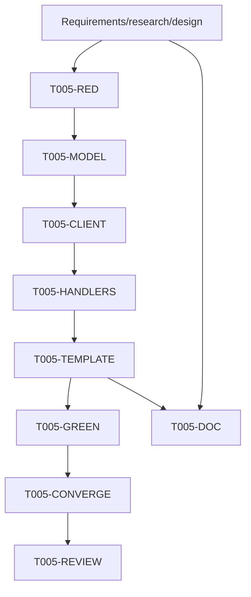

# Tasks: T005 Frontend C2 Submission Outcome UI

## Dependency graph

## Adjacency list

- `T005-REQ`: foundational; no dependency; validation: artifact consistency.
- `T005-RED`: depends on `T005-REQ`; add focused failing regression.
- `T005-MODEL`: depends on `T005-RED`; add contract/resolved-view types.
- `T005-CLIENT`: depends on `T005-MODEL`; fetch/decode/index monitor rows.
- `T005-HANDLERS`: depends on `T005-CLIENT`; merge outcome into list/detail.
- `T005-TEMPLATE`: depends on `T005-HANDLERS`; render statuses/details/actions.
- `T005-GREEN`: depends on `T005-TEMPLATE`; targeted and full tests/gofmt.
- `T005-CONVERGE`: depends on `T005-GREEN`; verify no unbuilt scoped work.
- `T005-REVIEW`: depends on `T005-CONVERGE`; diff review and isolated commit.
- `T005-DOC`: depends on `T005-REQ` and `T005-TEMPLATE`; update README or
  record that no root README exists/user-facing documentation is not applicable.

## Work items

### T005-REQ — Prepare scoped specification

- Deliverable: `requirements.md`, `research.md`, `design.md`, `tasks.md`, and
  `STATUS.md`, plus aligned `spec.md` and `plan.md`.
- Depends on: none.
- Acceptance: approved contract and scope are explicit; no backend/daemon work.
- Validation: inspect all artifacts for consistent six-state contract.

### T005-RED — Add base regression and prove red

- Deliverable: focused handler/template regression covering rejected,
  ambiguous, and pending outcomes.
- Depends on: T005-REQ.
- Acceptance: test fails at `18f7988` because current generic mapping ignores
  durable backend state.
- Validation: `go test ./handlers -run 'Test.*SubmissionOutcome' -count=1`.

### T005-MODEL — Define outcome view model

- Deliverable: frontend-only monitor row and resolved invoice outcome types.
- Depends on: T005-RED.
- Acceptance: all contract fields needed by list/detail are represented,
  including nullable retry/artifact/provider data.
- Validation: compile targeted handlers tests.

### T005-CLIENT — Read and index monitor outcomes

- Deliverable: authenticated helper for the approved monitor endpoint with
  compatibility decoding and non-fatal fallback.
- Depends on: T005-MODEL.
- Acceptance: state key wins over compatibility status; rows are keyed by
  invoice ID; unavailable monitor reads do not break invoice pages.
- Validation: focused mock-backend test.

### T005-HANDLERS — Merge outcome into page data

- Deliverable: list/detail handler mapping with issued truth and action flags.
- Depends on: T005-CLIENT.
- Acceptance: only accepted/accepted_with_warning set `is_issued`; non-success
  states carry provider/retry/artifact details.
- Validation: focused handler assertions.

### T005-TEMPLATE — Render localized states and safe actions

- Deliverable: invoice list/detail template updates.
- Depends on: T005-HANDLERS.
- Acceptance: explicit non-success state labels/classes render; issued-only
  actions are absent; legacy and credit-note behavior remains compatible.
- Validation: focused template assertions and template parse tests.

### T005-GREEN — Run formatting and tests

- Deliverable: formatted source and passing validation.
- Depends on: T005-TEMPLATE.
- Acceptance: `gofmt -l` clean; targeted tests and `go test ./...` pass.
- Validation: commands listed in task request.

### T005-CONVERGE — Converge scope

- Deliverable: no additional T005 implementation tasks remain.
- Depends on: T005-GREEN.
- Acceptance: backend/daemon worktrees remain untouched; docs align with code.
- Validation: inspect git diff/status and artifacts.

### T005-DOC — Update related documentation

- Deliverable: relevant README update if applicable, or explicit applicability
  record in `STATUS.md`.
- Depends on: T005-REQ and T005-TEMPLATE.
- Acceptance: no stale user-facing behavior description.
- Validation: inspect repository root for README and review `STATUS.md`.

### T005-REVIEW — Commit isolated PR-ready change

- Deliverable: one local commit on `fix/zatca/c2-submission-ui`.
- Depends on: T005-CONVERGE and T005-DOC.
- Acceptance: only T005/frontend files are included, required co-author
  trailer exists, and no push/PR is performed.
- Validation: `git status --short --branch` and `git show --stat --format=fuller HEAD`.
