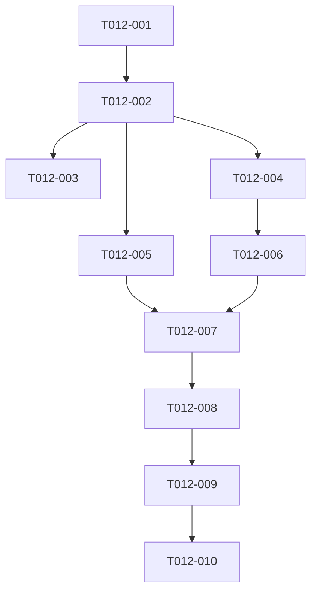

# T012 Tasks

## Phase 1: Specification and research

- [x] T012-001 Record requirements, assumptions, acceptance criteria, and
  frontend-only scope.
- [x] T012-002 Research the T010/T011 durable state/error contract and existing
  T028 behavior.
- [x] T012-003 Create design, plan, task graph, checklist, and status artifacts.

## Phase 2: Regression tests (red before production)

- [x] T012-004 Add a table-driven handler regression for invalid OTP,
  provider-unavailable, and done metadata; run it red.
  - Depends on: T012-002
  - Validation: `go test ./handlers -run 'TestHandleGetZatcaConfig.*Onboarding' -count=1`
- [x] T012-005 Add a template-source regression for localized state/error/retry
  rendering, false-active protection, and terminal polling cleanup; run it red.
  - Depends on: T012-002
  - Validation: `go test ./config -run 'TestT012.*' -count=1`

## Phase 3: Production implementation

- [x] T012-006 Extend frontend ZATCA response decoding and settings metadata
  projection without changing backend/daemon code.
  - Depends on: T012-004
  - Validation: focused handler test
- [x] T012-007 Add localized labels and update the settings template for
  progress, failures, retry reset, completion, false-active protection, and
  terminal polling shutdown while preserving T028.
  - Depends on: T012-005, T012-006
  - Validation: focused template test plus T028 regression

## Phase 4: Validation and convergence

- [x] T012-008 Run gofmt, targeted tests, and `go test ./...`; record any
  environment/contract limitations.
  - Depends on: T012-007
  - Validation: commands complete or blockers recorded
- [x] T012-009 Review diff for frontend-only scope, localization, security,
  settings UX, and T028 compatibility; update artifacts.
  - Depends on: T012-008
  - Validation: `git diff --check`, `git diff --name-only`
- [x] T012-010 Create one isolated local commit with the required co-author
  trailer; do not push or create a PR.
  - Depends on: T012-009
  - Validation: `git show --stat --format=fuller HEAD`

## Dependency graph

## Adjacency list

- `T012-001`: none
- `T012-002`: `T012-001`
- `T012-003`: `T012-002`
- `T012-004`: `T012-002`
- `T012-005`: `T012-002`
- `T012-006`: `T012-004`
- `T012-007`: `T012-005`, `T012-006`
- `T012-008`: `T012-007`
- `T012-009`: `T012-008`
- `T012-010`: `T012-009`

All implementation tasks are serial where they share the handler/template
contract. The two red tests are independent in files but both block the
production edit.
