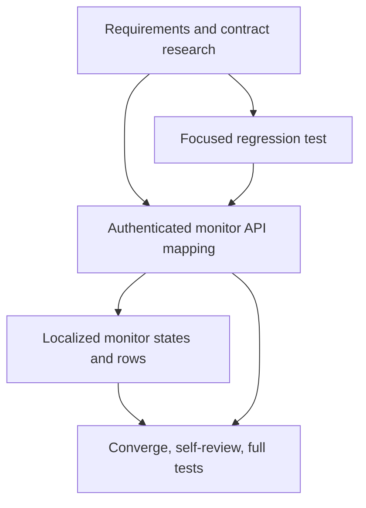

# T023 Tasks

## Dependency graph

Adjacency list:

- `T023-REQ`: depends on none; foundational blocker.
- `T023-TEST`: depends on `T023-REQ`; red regression gate.
- `T023-API`: depends on `T023-REQ` and `T023-TEST`.
- `T023-UI`: depends on `T023-API`.
- `T023-VERIFY`: depends on `T023-API` and `T023-UI`; final validation gate.

## Tasks

### T023-REQ — Record requirements and contract research

- Deliverable: `requirements.md`, `research.md`, `design.md`, `tasks.md`, and
  `STATUS.md`.
- Depends on: none.
- Acceptance: documented endpoints/fields and frontend constraints are explicit.
- Validation: review artifacts against the sibling contract.

### T023-TEST — Add focused red handler/template regression test

- Deliverable: authenticated `httptest.Server` test that asserts endpoint
  calls, auth, live values, and no mock total.
- Depends on: T023-REQ.
- Acceptance: test fails against baseline mocks.
- Validation: `go test ./handlers -run TestHandleZatcaMonitorUsesLiveBackendData`.

### T023-API — Wire authenticated monitor API mapping

- Deliverable: endpoint constants, nullable contract structs, concurrent
  authenticated fetches, safe decode/error handling, and presentation mapping.
- Depends on: T023-REQ, T023-TEST.
- Acceptance: no fixed demo values remain and partial failures do not become
  false success.
- Validation: focused handler test and `gofmt`.

### T023-UI — Render localized states and real rows

- Deliverable: template and label updates for status/warnings/provider refs,
  pending age, loading/error/empty states, and safe unavailable values.
- Depends on: T023-API.
- Acceptance: real data and all required states are visibly distinct.
- Validation: template parse/execute tests and focused handler test.

### T023-VERIFY — Converge and self-review

- Deliverable: updated status, documentation note, clean isolated commit.
- Depends on: T023-API, T023-UI.
- Acceptance: targeted tests, `go test ./...`, formatting, diff scope and
  frontend-only constraints pass; no push/PR.
- Validation: `gofmt -l`, targeted `go test`, `go test ./...`, `git diff`.
