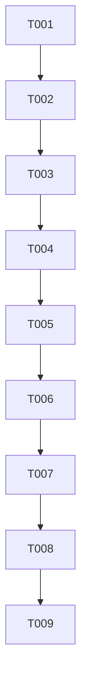

# T028 Tasks

## Phase 1: Setup

- [x] T001 Confirm the clean T028 worktree baseline at commit `18f7988` and record the scoped files in `STATUS.md`.

## Phase 2: Foundational

- [x] T002 Review `templates/settings.html`, `handlers/branch_store_address.go`, and existing Go/template tests against `requirements.md` and `design.md`.

## Phase 3: User Story 1 — Complete save before onboarding

**Goal:** A user can save branch configuration and its linked store address as
one prerequisite, with visible failures and no premature OTP onboarding.

**Independent test criteria:** `go test ./config -run TestT028ZatcaOnboardingWaitsForCompleteSave -count=1`
passes and the test checks pending state, awaited store save, failure rejection,
and modal ordering.

- [x] T003 [US1] Add the browserless regression test in `config/settings_zatca_flow_test.go` and run it red against the baseline fire-and-forget template.
- [x] T004 [US1] Update `templates/settings.html` so the complete ZATCA save awaits the linked store-address save, surfaces failures with existing localized status/toast UX, and keeps readiness controls disabled while pending.
- [x] T005 [US1] Update `templates/settings.html` so `openZatcaOtpModal` awaits a dirty or pending complete save and only exposes the OTP submit control after that save succeeds.

## Phase 4: Polish and validation

- [x] T006 Run `gofmt` on `config/settings_zatca_flow_test.go` and run the focused regression plus `go test ./config`.
- [x] T007 Run `go test ./...` as practical, record environment/runtime limitations in `STATUS.md`, and run `git diff --check`.
- [x] T008 Review the final diff for frontend-only scope, localization preservation, and requirement coverage; update `STATUS.md` and `quickstart.md`.
- [x] T009 Create one local isolated commit for T028 with the required co-author trailer; do not push or create a PR.

## Dependency graph

## Adjacency list

- `T001`: none
- `T002`: `T001`
- `T003`: `T002`
- `T004`: `T003`
- `T005`: `T004`
- `T006`: `T005`
- `T007`: `T006`
- `T008`: `T007`
- `T009`: `T008`

All tasks are intentionally serial because they share the same template/test
files and the user explicitly requested a red-before-production-edit sequence.

## Parallel execution opportunities

None. The regression test and production template share the behavior under
test, and validation depends on both.

## Implementation strategy

Use the smallest MVP path: prove the baseline race with T003, implement the
promise/pending-state guard in T004–T005, then run focused and full validation
before the isolated commit.
