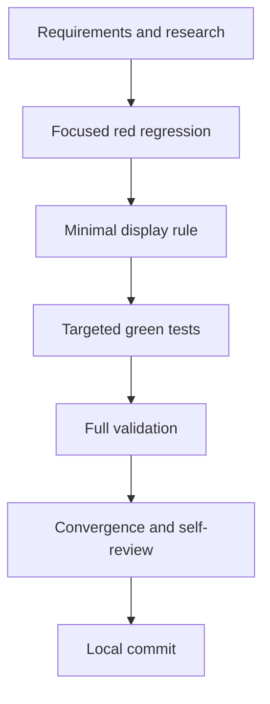

# T032 Import Failure State Tasks

## Dependency graph

## Dependency-ordered tasks

- [x] **T032-FS-REQ** Create requirements, research, design, plan, spec,
  tasks, checklist, and status artifacts. Validation: artifact consistency
  review.
- [x] **T032-FS-RED** Add the posted failure-state regression and run the exact
  test against `afc6b71`. Validation: the test fails for the base behavior.
- [x] **T032-FS-IMPL** Extend the existing failure display override to include
  posted while preserving successful posted imports. Validation: focused test.
- [x] **T032-FS-GREEN** Run targeted handler/template tests after the fix.
  Validation: targeted `go test`.
- [x] **T032-FS-VALIDATE** Run gofmt, `go test ./...`, and `git diff --check`.
  Validation: command output; retry the full suite with
  `go clean -testcache` only for a Windows executable lock.
- [x] **T032-FS-CONVERGE** Reconcile artifacts and self-review the diff,
  localization, action behavior, and scope. Validation: no unresolved
  requirement gaps.
- [x] **T032-FS-COMMIT** Update the SQL todo and create one local commit with
  the required co-author trailer. Validation: clean post-commit status except
  for intentionally untracked runtime files, no push or PR.

## Adjacency list

- T032-FS-REQ: none
- T032-FS-RED: T032-FS-REQ
- T032-FS-IMPL: T032-FS-RED
- T032-FS-GREEN: T032-FS-IMPL
- T032-FS-VALIDATE: T032-FS-GREEN
- T032-FS-CONVERGE: T032-FS-VALIDATE
- T032-FS-COMMIT: T032-FS-CONVERGE

## Validation commands

- Red: `go test ./handlers -run '^TestPrepareZatcaImportViewPostedFailureEvidence$'`
- Targeted: `go test ./handlers ./config`
- Full: `go test ./...`
- Format: `gofmt -w handlers/zatca_import.go handlers/zatca_import_ui_test.go`
- Diff: `git diff --check`
