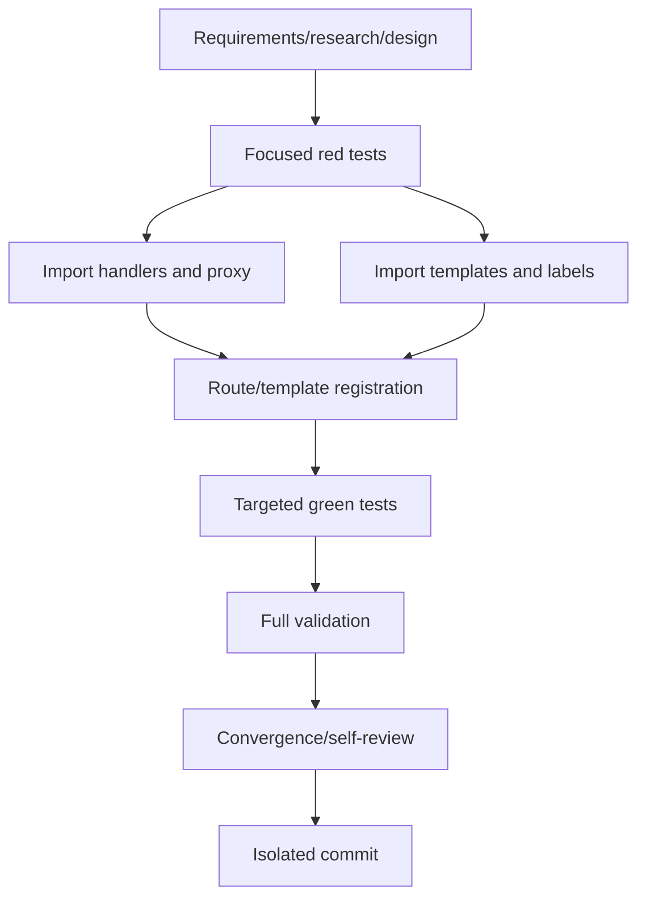

# T032 Tasks

## Dependency graph

## Dependency-ordered tasks

- [x] **T032-REQ** Create requirements, research, design, plan, spec, tasks,
  and status artifacts. Validation: artifact consistency review.
- [x] **T032-RED** Add browserless handler/template tests and run them against
  the clean base. Validation: focused `go test` fails because the import view
  and handler do not exist.
- [x] **T032-HANDLER** Implement authenticated list/detail page handlers and
  T031 create/list/detail/review/post/reject JSON proxies. Validation:
  focused handler tests.
- [x] **T032-TEMPLATES** Add upload/list/detail/status templates and localized
  labels with explicit pending/failed/rejected/posted semantics. Validation:
  template parse/execute tests and source contract assertions.
- [x] **T032-ROUTES** Register templates and authenticated singular/plural page
  and API aliases without touching settings/onboarding routes. Validation:
  route/handler tests and diff scope review.
- [x] **T032-GREEN** Run focused tests plus related config/handler tests.
  Validation: targeted `go test`.
- [x] **T032-VALIDATE** Run gofmt, `go test ./...`, and `git diff --check`;
  record browser/live-storage limitations. Validation: command output.
- [x] **T032-CONVERGE** Reconcile artifacts with the final diff and self-review
  localization, auth, status, and no-false-issued requirements.
- [ ] **T032-COMMIT** Create one local commit with the required co-author
  trailer; do not push or create a PR.

## Adjacency list

- T032-REQ: none
- T032-RED: T032-REQ
- T032-HANDLER: T032-RED
- T032-TEMPLATES: T032-RED
- T032-ROUTES: T032-HANDLER, T032-TEMPLATES
- T032-GREEN: T032-ROUTES
- T032-VALIDATE: T032-GREEN
- T032-CONVERGE: T032-VALIDATE
- T032-COMMIT: T032-CONVERGE

T032-HANDLER and T032-TEMPLATES are logically independent, but are kept in
one worktree and one serial implementation wave to preserve the required
red-before-production-edit proof and avoid concurrent edits.
