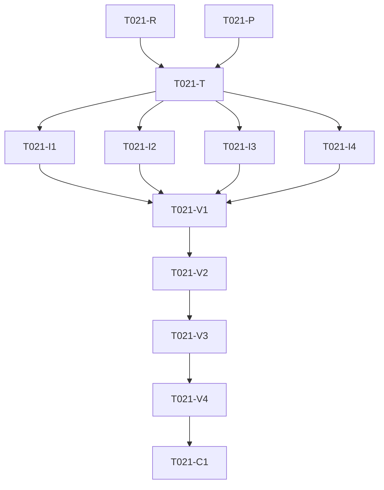

---

description: "Dependency-ordered tasks for T021 invoice detail QR rendering"
---

# Tasks: Invoice Detail ZATCA QR Rendering

**Input**: Design documents from `specs/001-invoice-qr-detail/`

**Scope**: T021 frontend only; no monitor, onboarding, outcome, or backend
schema work.

## Phase 1: Specification and research

- [x] T021-R [P] Create `requirements.md`, `research.md`, `design.md`, and `spec.md` under `specs/001-invoice-qr-detail/`
- [x] T021-P [P] Create `plan.md`, `data-model.md`, `quickstart.md`, and `STATUS.md` under `specs/001-invoice-qr-detail/`

## Phase 2: User Story 1 — Render persisted invoice ZATCA data (Priority: P1)

**Goal**: An invoice detail user sees the persisted ZATCA QR and optional
artifact/reference values, while an empty QR remains localized and safe.

**Independent test**: Run the focused handler/template regression against a
mock bill response containing persisted and empty QR variants.

### Red-first tests

- [x] T021-T [US1] Add `handlers/invoice_detail_qr_test.go` covering persisted `qr_code`, optional `invoice_uuid`/`invoice_hash`/`invoice_xml_path`, unchanged issued status, and empty QR safety; verify it fails before the handler fix

### Implementation

- [x] T021-I1 [US1] Preserve optional `invoice_uuid`, `invoice_hash`, and `invoice_xml_path` in `helpers/api_helpers.go` `ParseBillRaw`
- [x] T021-I2 [US1] Map normalized `qr_code`, pending state, and optional artifact/reference values in `handlers/invoices.go` without changing status helpers
- [x] T021-I3 [US1] Update `templates/invoice-detail.html` to render persisted QR only when non-empty, show localized pending text otherwise, and conditionally render escaped artifact/reference values
- [x] T021-I4 [US1] Add localized invoice QR pending and ZATCA artifact/reference labels in `resources/labels.go`

## Phase 3: Validation and convergence

- [x] T021-V1 Run `gofmt` on `handlers\invoice_detail_qr_test.go`, `handlers\invoices.go`, and `helpers\api_helpers.go`
- [x] T021-V2 Run `go test ./handlers -run TestHandleGetInvoiceRendersPersistedZATCAQR -count=1`
- [x] T021-V3 Run `go test ./handlers ./config -count=1`
- [x] T021-V4 Run `go test ./...`
- [x] T021-C1 Review the final diff, verify scope exclusions, update `STATUS.md`, and create the isolated local commit

## Dependency Graph

Adjacency list:

- `T021-R`: no dependencies; requirements/research/design foundation
- `T021-P`: no dependencies; plan and validation artifacts
- `T021-T`: depends on `T021-R`, `T021-P`; red-first regression
- `T021-I1`: depends on `T021-T`; parser pass-through
- `T021-I2`: depends on `T021-T`; handler template-data mapping
- `T021-I3`: depends on `T021-T`; localized safe template behavior
- `T021-I4`: depends on `T021-T`; localization resources
- `T021-V1`: depends on all implementation tasks; formatting gate
- `T021-V2`: depends on `T021-V1`; focused regression gate
- `T021-V3`: depends on `T021-V2`; related package gate
- `T021-V4`: depends on `T021-V3`; full Go test gate
- `T021-C1`: depends on `T021-V4`; convergence, self-review, commit

## Parallel Opportunities

- `T021-R` and `T021-P` are independent artifact tasks.
- `T021-I1`, `T021-I2`, `T021-I3`, and `T021-I4` were conceptually separate
  but were implemented in one sequential wave because they share the invoice
  detail data path and must be reviewed together.

## Completion Gates

- Red-first regression must fail because `qr_code` is absent from template data.
- Green focused and package tests must pass after implementation.
- `go test ./...` and `git diff --check` must pass before commit.
- The final diff must not include monitor, onboarding, or outcome schema work.
