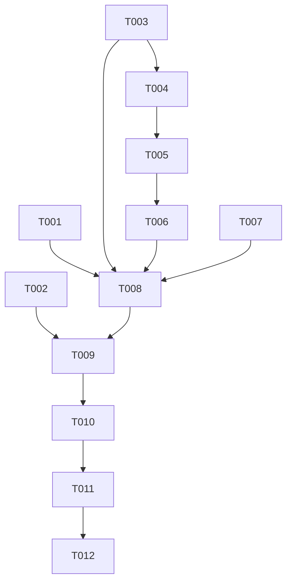

# Tasks: PR #91 Direct Contract Blockers

## Phase 1: Setup

No dependency or project initialization changes are planned. Use the existing frontend and backend worktrees and the feature directory recorded in `.specify/feature.json`.

## Phase 2: Foundational

The verified API contracts and implementation decisions are recorded in `requirements.md`, `research.md`, `design.md`, and `contracts/`. No shared schema migration is required.

## Phase 3: User Story 1 — Complete a sale accurately (P1)

**Independent test criteria**: Product and manual line discounts survive the actual backend insert and totals refresh; a quick draft sends a valid selected branch and payment method and blocks when context is missing.

- [x] T001 Persist sale-line discounts without changing the existing formula in `pkg/db/queries/bill.sql`, `pkg/handlers/bill.go`, and generated `pkg/db/gen/`; add a focused regression in `pkg/handlers/bill_line_discount_test.go`.
  - Depends on: none
  - Acceptance: a non-zero line discount reaches the existing `bill_product.discount` insert and the existing generated line/bill total calculations remain unchanged.
  - Validation: `go test ./pkg/handlers -run 'Test.*(Sale|Discount)'`; run `sqlc generate` and `gofmt`.
- [x] T002 Verify quick-draft request context in `handlers/sale_identity_test.go` and the draft request handler.
  - Depends on: none
  - Acceptance: selected store's valid branch and cash payment method `10` are submitted; missing branch/context sends no request and surfaces an actionable error.
  - Validation: `go test ./handlers -run 'Test.*(QuickDraft|SaleIdentity)'`.

## Phase 4: User Story 2 — Issue a credit note or import a purchase (P1)

**Independent test criteria**: A credit note is constructed only from an exact backend full-remaining snapshot; purchase import calls a registered protected handler, sends all required item/supplier/payment fields, and returns truthful per-item outcomes.

- [x] T003 Add the read-only full-remaining credit-source endpoint and focused tests in backend `main.go`, `pkg/handlers/credit.go`, and `pkg/handlers/credit_source_test.go`.
  - Depends on: none
  - Acceptance: the endpoint returns branch, exact remaining amount, and remaining source-line IDs/quantities/prices/VAT; it refuses drafts, inaccessible/unavailable bills, missing line metadata, fully credited bills, and unreconciled amounts.
  - Validation: `go test ./pkg/handlers -run 'Test.*(Credit|CreditSource)'`.
- [x] T004 Build the credit-note POST server-side from a fresh source snapshot in frontend `handlers/invoices.go`, `templates/add-credit-note.html`, and `main.go`.
  - Depends on: T003
  - Acceptance: reason is required; payload includes valid branch and stable `pos_id`/`bill_request_id`, positive amount, and full remaining lines; client-submitted amount/line values are not trusted.
  - Validation: `go test ./handlers -run 'Test.*(CreditNote|CreditSource)'`.
- [x] T005 Add the protected purchase bulk-import proxy and required request fields in frontend `main.go`, `handlers/purchase_bill_bulk_import.go`, `templates/import-purchase-bills.html`, and focused handler/template tests.
  - Depends on: T004 (same frontend worktree; serialize edits to shared route registration)
  - Acceptance: the JSON array reaches backend `/api/v2/purchase_bill`; supplier sequence, payment method, and cost price are required; each bill receives an indexed success or explicit error result.
  - Validation: `go test ./handlers -run 'Test.*(BulkPurchaseBillImport|PurchaseImport)'`.

## Phase 5: User Story 3 — Preserve business dates and sale identity (P1)

**Independent test criteria**: A date-only Excel value keeps its Riyadh calendar date through RFC3339 serialization; reload/back/retry of the same sale history entry retains its request ID while a new entry gets a new ID.

- [x] T006 Preserve Riyadh calendar dates in `templates/import-purchase-bills.html` and normalize date-only purchase requests in `handlers/purchase_bill_bulk_import.go` and `static/js/purchase-import-dates.js`.
  - Depends on: T005
  - Acceptance: UTC date slicing is removed; date-only input becomes RFC3339 with `+03:00`; missing or unparseable dates fail visibly.
  - Validation: `go test ./handlers -run 'Test.*(Purchase.*Date|Riyadh|BulkPurchaseBillImport)'` and `node --test js-tests/purchase-import-dates.test.js`.
- [x] T007 Bind sale attempt identity to a history entry in `static/js/sale-identity.js` and `js-tests/sale-identity.test.js`.
  - Depends on: none
  - Acceptance: the same history entry keeps identity on reload/back/resume/retry/double-submit; a newly navigated sale entry and a separate tab get distinct request IDs.
  - Validation: `node --test js-tests\sale-identity.test.js`.

## Phase 6: Polish and delivery

- [x] T008 Update existing relevant backend `README.md` sections with the changed workflows and backend dependency/merge order; record that the frontend worktree has no root `README.md` rather than creating a duplicate project overview.
  - Depends on: T001, T003, T004, T005, T006, T007
  - Acceptance: existing README documentation accurately describes the workflows it owns; the frontend README absence is recorded.
  - Validation: review changed README sections against implementation and contracts; record any repository with no relevant README.
- [x] T009 Run focused and repository-required Go/JS checks; fix failures in touched files and record exact results in `STATUS.md`.
  - Depends on: T002, T004, T005, T006, T007, T008
  - Acceptance: focused regressions pass; required build/vet/test/lint/format checks pass or are recorded as blocking failures.
  - Validation: commands in `quickstart.md` plus the relevant repository checks.
- [x] T010 Run post-implementation Spec Kit convergence and self-review all source and artifacts in `specs/001-pr91-direct-contract-blockers/`.
  - Depends on: T009
  - Acceptance: no requirement gaps, stale status, unverified contract claims, or unresolved generated tasks remain; convergence reports complete. Record that read-only analysis was performed manually after implementation began because the prerequisite helper is absent.
  - Validation: reconcile with the recorded manual analysis, run `/speckit-converge`, and review the final diff.
- [ ] T011 Obtain independent approval from `copilot-pr91-qa`, then commit and non-force push the approved updates to backend PRs #105/#108 and the existing frontend PR #91 branch.
  - Depends on: T010
  - Acceptance: the designated QA approves the current feature-chat revision before push; commits include the required Co-authored-by trailer; no force push or amend.
  - Validation: verify all push commands are fast-forward and GitHub PR heads reflect the intended commits.
- [ ] T012 Verify GitHub head SHAs and record criterion evidence in the feature chat and `STATUS.md`.
  - Depends on: T011
  - Acceptance: PR #91 and any required backend PR heads match local commits; all applicable acceptance criteria have evidence; QA approval remains on the current revision.
  - Validation: `pull_request_read` for each updated PR and final feature-chat snapshot.

## Dependency graph

### Dependency adjacency list

- T001: none; must finish before documentation/validation.
- T002: none; must finish before validation.
- T003: none; T004 consumes this endpoint contract; T008 documents it.
- T004: T003; T005 is serialized after it because both edit frontend route registration in one worktree.
- T005: T004; T006 uses the bulk handler's date normalization.
- T006: T005; T008 documents it.
- T007: none; T008 documents it.
- T008: T001, T003, T004, T005, T006, T007.
- T009: T002, T004, T005, T006, T007, T008.
- T010: T009.
- T011: T010.
- T012: T011.

## Parallel execution

- Backend #105 discount work (T001) and backend #108 credit-source work (T003) use separate worktrees and may be developed in parallel; the stacked #108 branch must incorporate the final #105 base before push.
- Frontend tasks are serialized in one worktree to avoid concurrent writers to `main.go` and shared handlers/templates. T002 and T007 touch distinct frontend files but remain with the same frontend writer.
- Final validation, convergence, QA, and pushes are sequential gates.

## Implementation strategy

No partial production release is complete: all six blockers are required. Implement backend contracts first, complete the frontend requests, then run focused tests, documentation/convergence, independent QA, and non-force PR updates.
