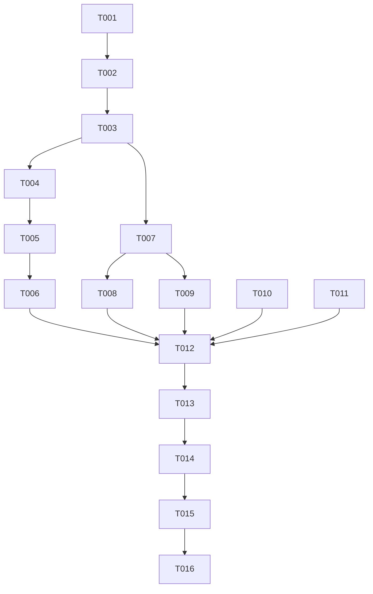

# Tasks: PR91 Warning-Only Frontend Validation

## Phase 1: Setup

- [x] T001 Create and review the scoped Spec Kit artifacts in `specs/002-pr91-warning-validation/`

## Phase 2: Foundational

- [x] T002 Review PR #91 and define the warning boundary in `research.md` and `design.md`
- [x] T003 Preserve hard-failure paths and backend authority in `handlers/invoices.go` and `handlers/purchase_bill_bulk_import.go`

## Phase 3: User Story 1 - Review a purchase import warning

Independent test criteria: A business-invalid but serializable row displays a warning,
the preview remains available, the unchanged payload is submitted, and backend
per-row results are visible.

- [x] T004 [P] [US1] Extract purchase row checks into `static/js/purchase-import-validation.js`
- [x] T005 [US1] Render a non-blocking preview warning and continue submission in `templates/import-purchase-bills.html`
- [x] T006 [US1] Add valid, invalid, and no-mutation coverage in `js-tests/purchase-import-validation.test.js`

## Phase 4: User Story 2 - Submit a credit note with backend validation

Independent test criteria: Invalid-but-serializable reason or identity values reach
the backend, backend rejection is returned, and a corrected retry is not held by a
stale frontend cache.

- [x] T007 [US2] Remove the credit-note business preflight gate and preserve submitted values in `handlers/invoices.go`
- [x] T008 [US2] Add warning-only reason guidance without native blocking validation in `templates/add-credit-note.html`
- [x] T009 [US2] Update handler tests for backend forwarding, unchanged reason, cache recovery, and rendered guidance in `handlers/credit_note_test.go`

## Phase 5: User Story 3 - Preserve hard failures

Independent test criteria: Unreadable uploads, malformed requests, authentication/
CSRF failures, request-size failures, and unavailable or unverified credit sources
retain explicit failure behavior.

- [x] T010 [US3] Retain source verification and structured bulk-request failures in `handlers/invoices.go` and `handlers/purchase_bill_bulk_import.go`
- [x] T011 [US3] Retain existing hard-failure assertions in `handlers/credit_note_test.go` and `handlers/purchase_bill_bulk_import_test.go`

## Phase 6: Polish and cross-cutting validation

- [x] T012 Add localized warning labels in `resources/labels.go`
- [x] T013 Record behavior, validation commands, and the absence of a repository README in `STATUS.md` and `quickstart.md`
- [x] T014 Run `npm run check`, focused tests, `git diff --check`, and self-review; record any baseline-only failures in `STATUS.md`
- [x] T015 Obtain independent QA review and approval for the current feature-chat revision
- [x] T016 Run convergence review and close any newly discovered in-scope tasks

## Dependency graph

Adjacency list:

- T001: none
- T002: T001
- T003: T002
- T004: T003
- T005: T004
- T006: T005
- T007: T003
- T008: T007
- T009: T007
- T010: T003
- T011: T003
- T012: T006, T008, T009, T010, T011
- T013: T012
- T014: T013
- T015: T014
- T016: T015

Parallel-ready work:

- T004 and T007 can proceed in parallel after T003 because they touch separate
  validation boundaries.
- T008 and T009 can proceed in parallel after T007.

## Implementation strategy

Deliver User Story 1 and User Story 2 together because both define the warning-only
boundary, retain User Story 3's hard failures, then run the final repository and QA
gates. No schema or migration work is required.
